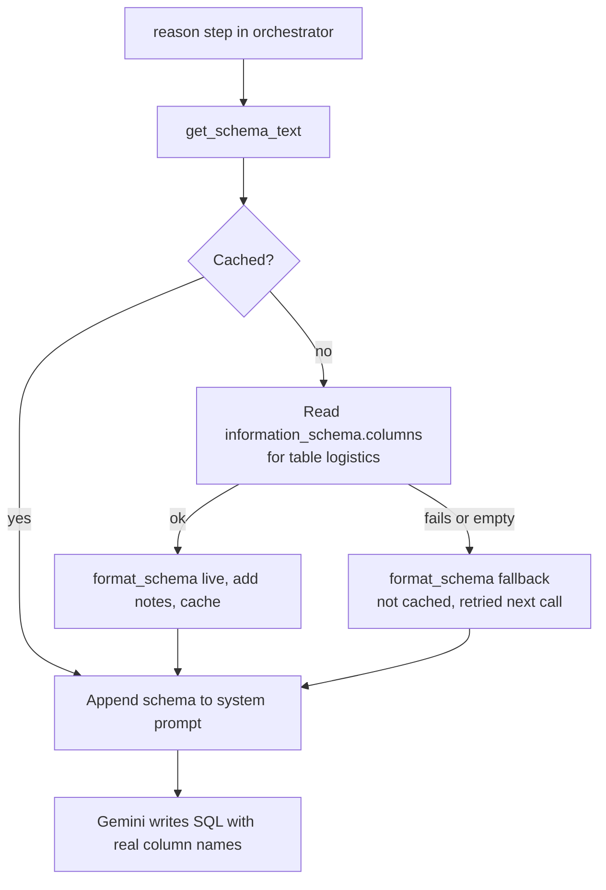

# Feature 01: Schema-aware SQL

Status: implemented, 2026-11-25. Not yet deployed or tested with live Gemini questions.
Resolves: known issue 1 in `progress-tracker.md` (schema mismatch).

## Problem

The agent prompt named a PostgreSQL tool but gave no table schema. Gemini guessed column names and types. The real table comes from `data/logistics.csv` through pandas `to_sql`, so it differs from what a model would expect:

- Column names are the CSV names (`cargo_condition_status`, `fatigue_monitoring_score`, `shipping_costs` and so on), not those in `db/init.sql`.
- `cargo_condition_status`, `route_risk_level` and `order_fulfillment_status` are numeric scores, not text labels.
- `timestamp` is stored as `text`.
- Only `risk_classification` is a text label (`High Risk`, `Moderate Risk`, `Low Risk`).
- There is no shipment ID or primary key.

Wrong guesses produced SQL errors or empty results, and the agent had to report missing evidence.

## Solution

Give the model the real schema in the system prompt on every reasoning step.



### Design decisions

| Decision | Reason |
|----------|--------|
| Read the live schema from `information_schema` | Names and types stay correct if the table is reloaded. Works on local PostgreSQL and Neon. |
| Add hand-written notes per column (meaning and observed range) | Types alone do not say that `route_risk_level` is a 0-10 score. Notes come from the CSV. |
| Static fallback list | The app still gets a usable schema if the metadata query fails. A failure is logged, not cached. |
| Cache only live results | Avoids one extra query per reasoning step, and retries after a failed read. |
| Prompt injection instead of a schema tool | One fewer model round trip per question. The schema is small (26 columns). |
| Tell the model to add `LIMIT` of 50 or less | Keeps tool output small. |

## Files changed

| File | Change |
|------|--------|
| `tools/schema_tool.py` | New. `get_schema_text()`, `format_schema()`, `COLUMN_NOTES`, `FALLBACK_COLUMNS`, `reset_schema_cache()`. |
| `agent/orchestrator.py` | Imports `get_schema_text`. `reason()` appends the schema to the system prompt. Prompt line "ChromaDB RAG" changed to "SOP vector search (RAG)". |

## Invariants kept

- SQL is still validated by `validate_sql_readonly` and run in a read-only transaction. The schema query runs on its own connection and only reads metadata.
- No secrets are placed in the prompt. Only column names, types and notes.
- If the schema cannot be read, the agent still runs with the fallback.

## Example

Question: "Which readings have a high risk classification and temperature above 8?"

Before: the model might filter `cargo_condition = 'High'` or `risk_level = 'High'`.
After: the schema shows `risk_classification` is text with `'High Risk'`, and `iot_temperature` is a double, so the model writes:

```sql
SELECT timestamp, iot_temperature, risk_classification
FROM logistics
WHERE risk_classification = 'High Risk' AND iot_temperature > 8
LIMIT 50
```

## Verification

Done:
- `get_schema_text()` run against the configured Neon database returned `live` schema with all columns and notes, and `timestamp` reported as `text`.
- `pytest -m "not integration"`: 6 passed.

Not done:
- Live Gemini questions through the UI (needs the API key and a running app). Suggested checks:
  1. "How many records are in the logistics table?"
  2. "How many readings are High Risk?"
  3. "What is the average iot_temperature for Low Risk readings?"
  4. "Show readings in January 2021 with temperature above 8." (needs `CAST(timestamp AS timestamp)` or string compare)
- Unit tests for `format_schema` and the fallback path (not added; no tests were requested).

## Limitations and follow-ups

- `COLUMN_NOTES` ranges are observed from the CSV and need a manual update if the data changes.
- The schema adds roughly 1,000 tokens to each reasoning step.
- The data looks synthetic and normalized: `iot_temperature` runs from -10 to 40 C and cargo condition is a score. The agent may compare it with the SOP 2-8 C range, which is a business question to settle.
- `db/init.sql` still describes a different table and no code uses it. Deleting or aligning it needs user approval.
- Deployment: Streamlit Cloud picks the change up on the next `git push`. No new secrets or dependencies.
