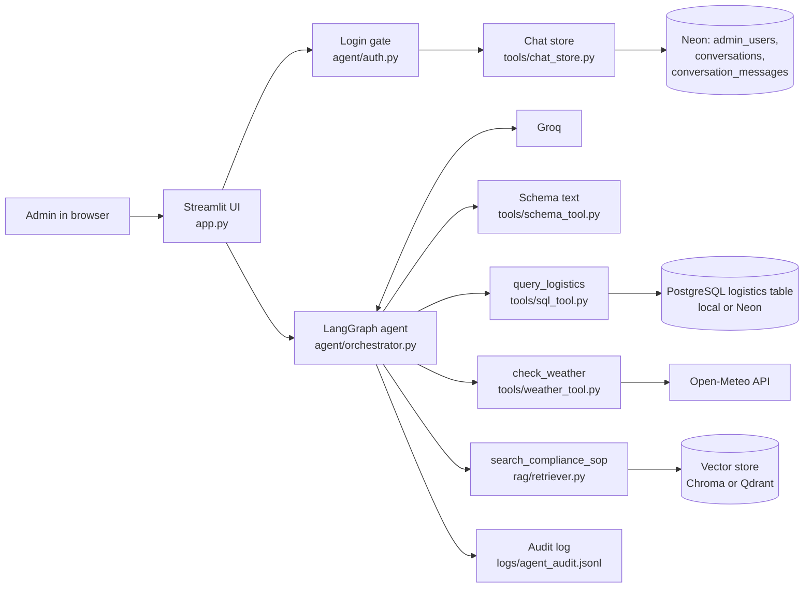
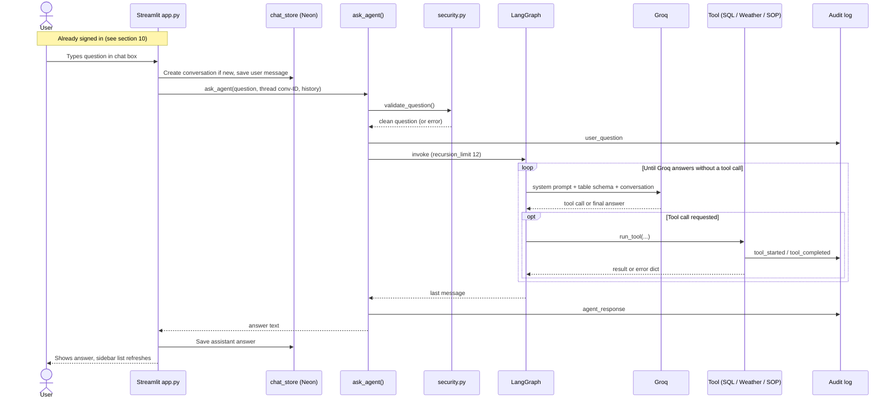
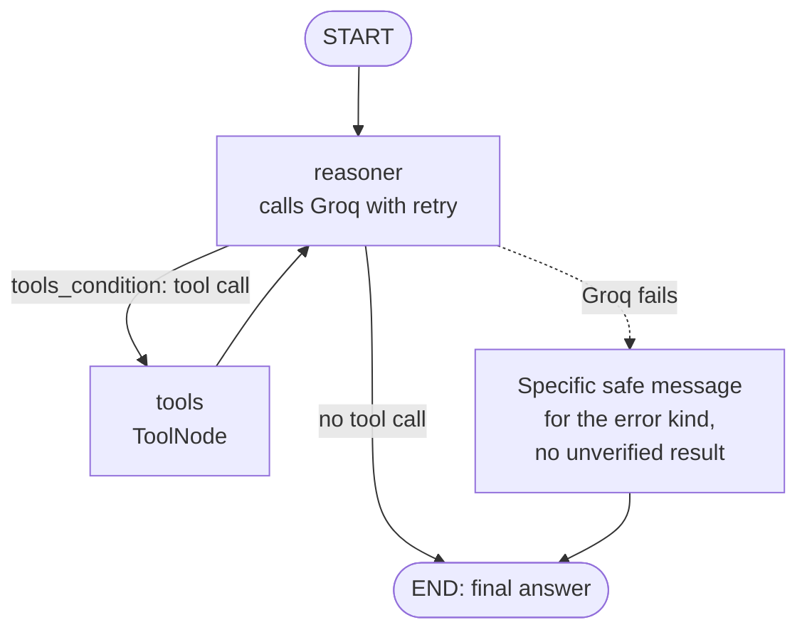
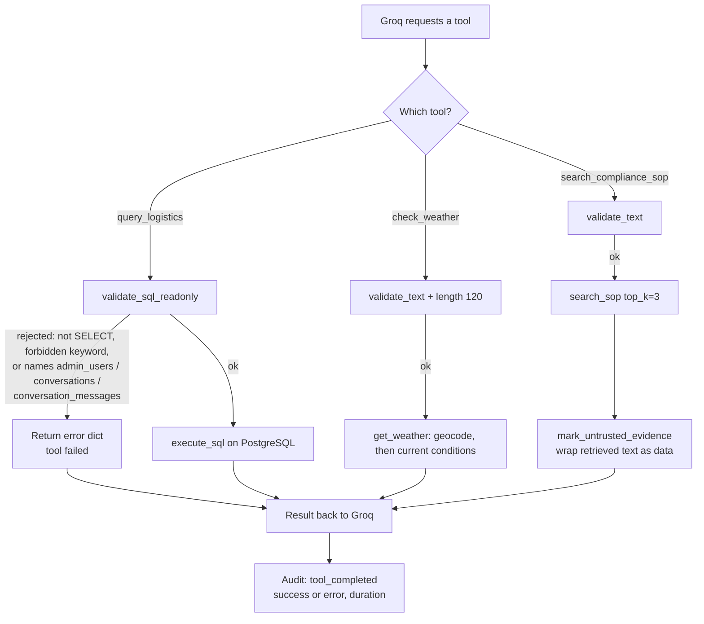
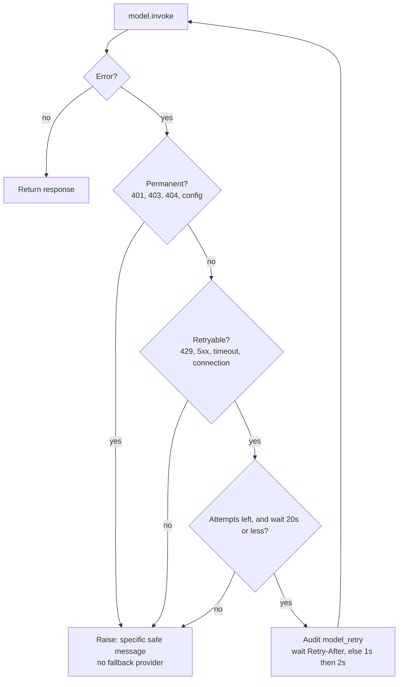
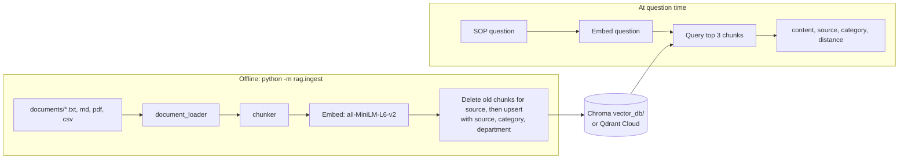
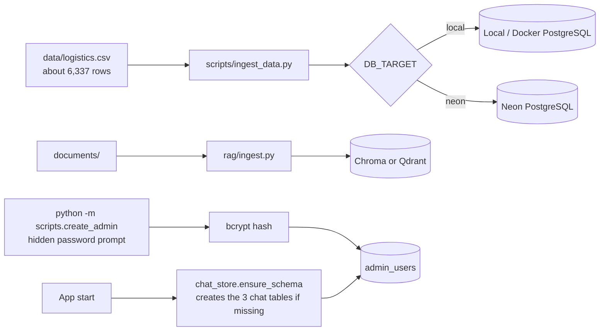
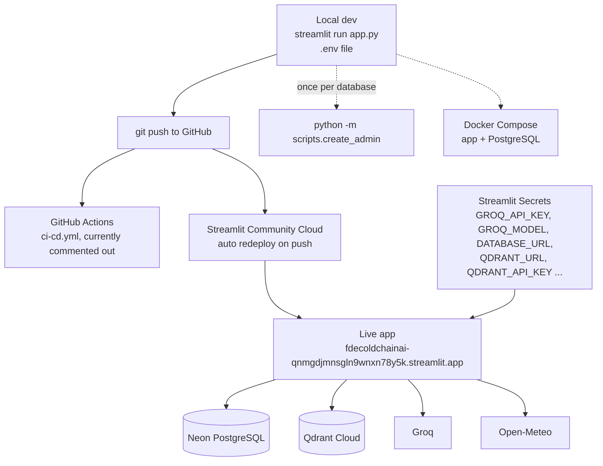
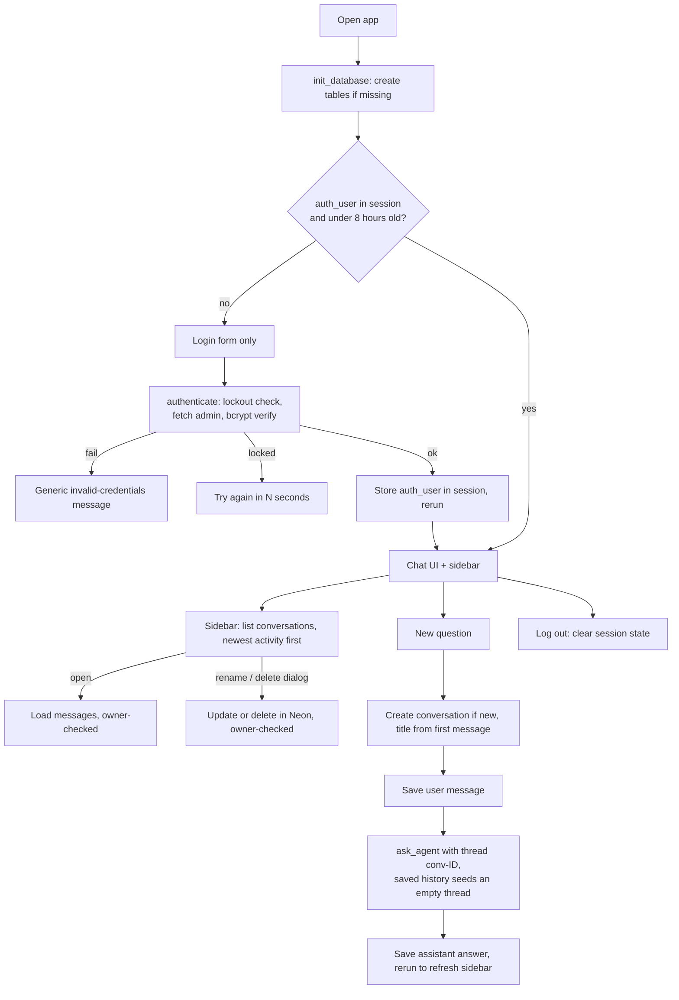
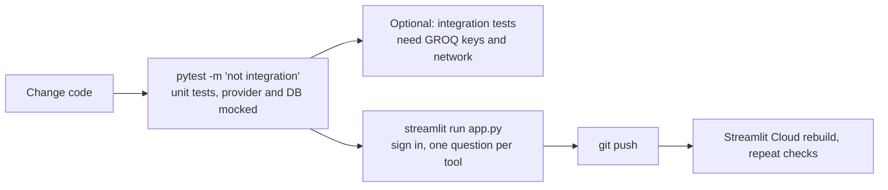

# Product Workflow

Diagrams of how Cold Chain AI works, from data setup to a user's answer. They are written in Mermaid, which renders on GitHub and in the Kiro/VS Code markdown preview.

Source files named in each diagram are the ground truth. If code changes, update the matching diagram.

## 1. System overview

## 2. Request lifecycle (one question)

## 3. Agent graph (LangGraph)

Conversation memory is kept per `thread_id` (`conv-<conversation id>`) in `MemorySaver`, in process memory. After a restart, `restore_history()` seeds an empty thread with the last 20 saved messages from Neon, so reopened conversations keep their context. Each reasoning step also appends the live `logistics` column list and notes (`tools/schema_tool.py`) to the system prompt.

## 4. Tool execution and safety checks

Rules enforced: read-only SQL, admin and chat tables unreadable by the agent, secrets redacted in logs, retrieved SOP text treated as untrusted data, raw exception details not shown to the model.

## 5. Model retry

## 6. SOP knowledge pipeline (RAG)

`VECTOR_DB_PROVIDER` selects the store. `rag/migrate_chroma_to_qdrant.py` copies an existing Chroma store to Qdrant.

## 7. Data setup

Both the app and the script write to the same database chosen by `DB_TARGET`.

## 8. Environments and deployment

Full deployment steps are in `project-overview.md` under "Live deployment". Nobody can sign in until an admin exists in the target database.

## 9. Configuration map

| Variable | Used by | Effect |
|----------|---------|--------|
| `GROQ_API_KEY`, `GROQ_MODEL` | `agent/config.py`, `agent/orchestrator.py` | Groq access and model ID (environment, then Streamlit secrets) |
| `DB_TARGET` (`local` or `neon`) | `tools/sql_tool.py`, `scripts/ingest_data.py` | Chooses the database |
| `DATABASE_URL` | same | Neon connection string |
| `DB_HOST`, `DB_PORT`, `DB_NAME`, `DB_USER`, `DB_PASSWORD` | same | Local PostgreSQL |
| `VECTOR_DB_PROVIDER` (`chroma` or `qdrant`) | `rag/vector_store.py` | Chooses the vector store |
| `QDRANT_URL`, `QDRANT_API_KEY`, `QDRANT_COLLECTION` | `rag/vector_store.py` | Qdrant Cloud |
| `CHROMA_PATH` | `rag/vector_store.py` | Local Chroma folder |
| `AUDIT_LOG_PATH` | `agent/audit_logger.py` | Audit log file location |

Login settings are constants in `agent/auth.py` (5 failures, 5-minute lockout, 8-hour session), not environment variables.

## 10. Login and conversation history

The login gate sits in front of everything: until `auth_user` is set, `app.py` calls `st.stop()` before any agent, conversation or sidebar code runs. Every `chat_store` call filters by the signed-in admin's ID.

## 11. Test and verification flow

