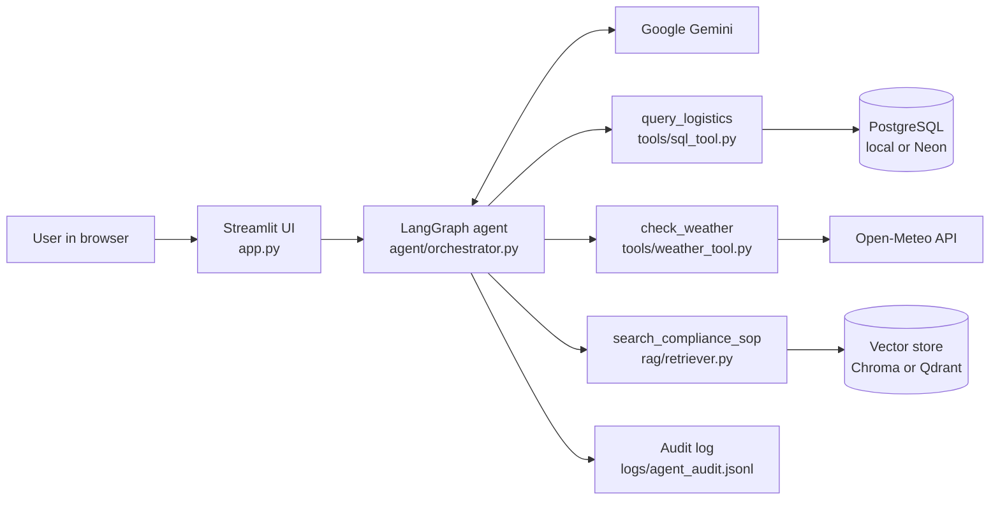
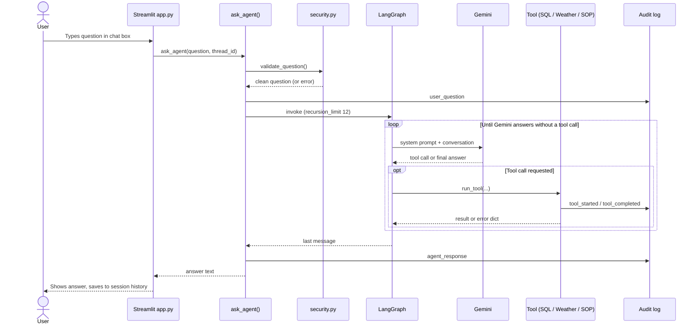
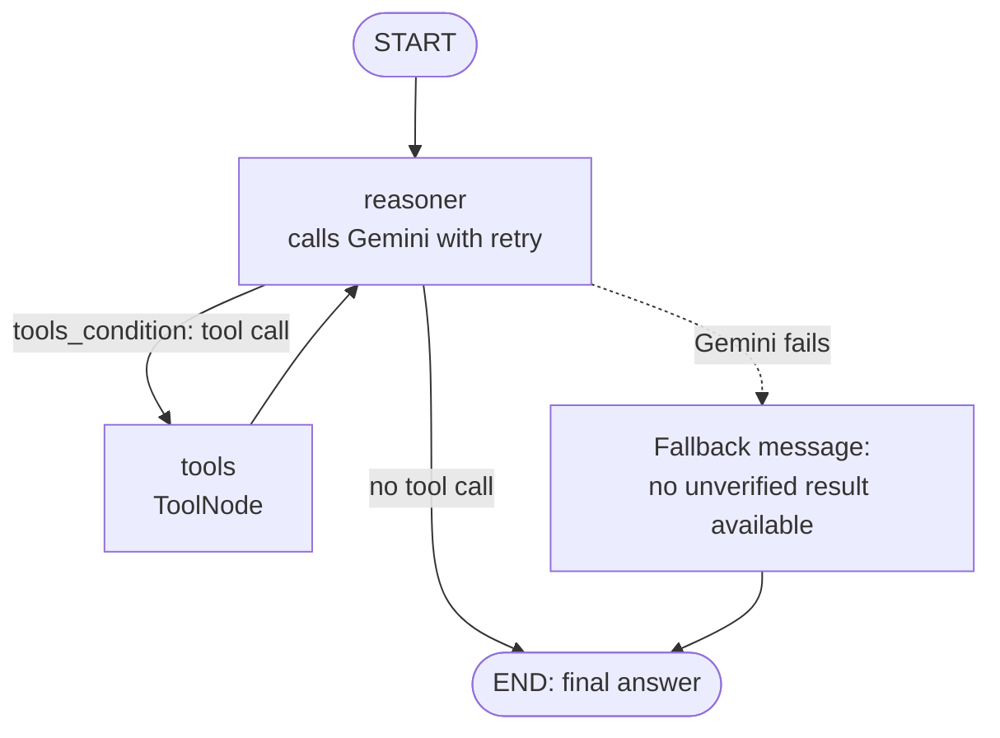
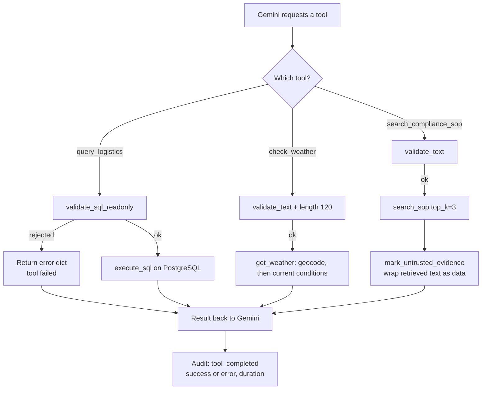
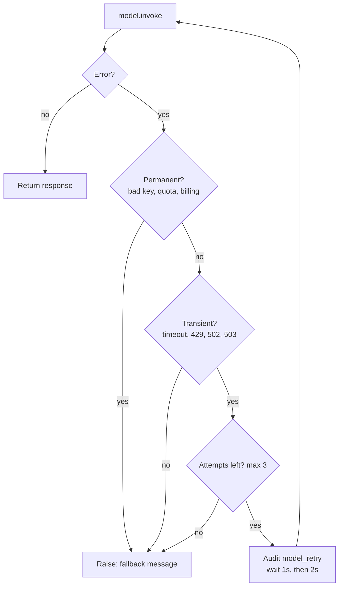
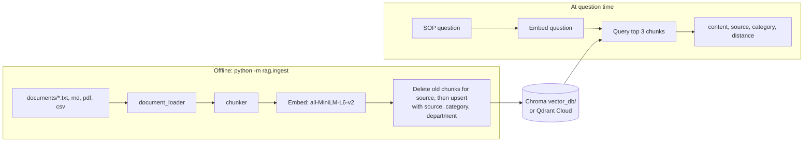
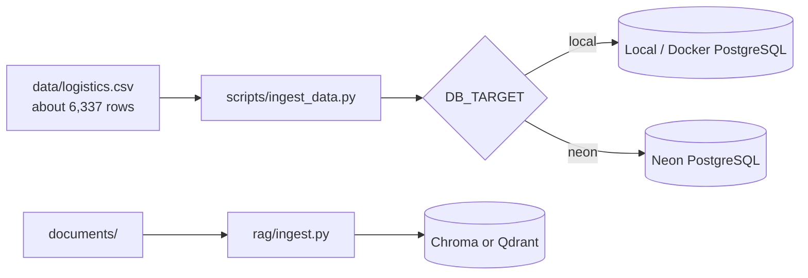
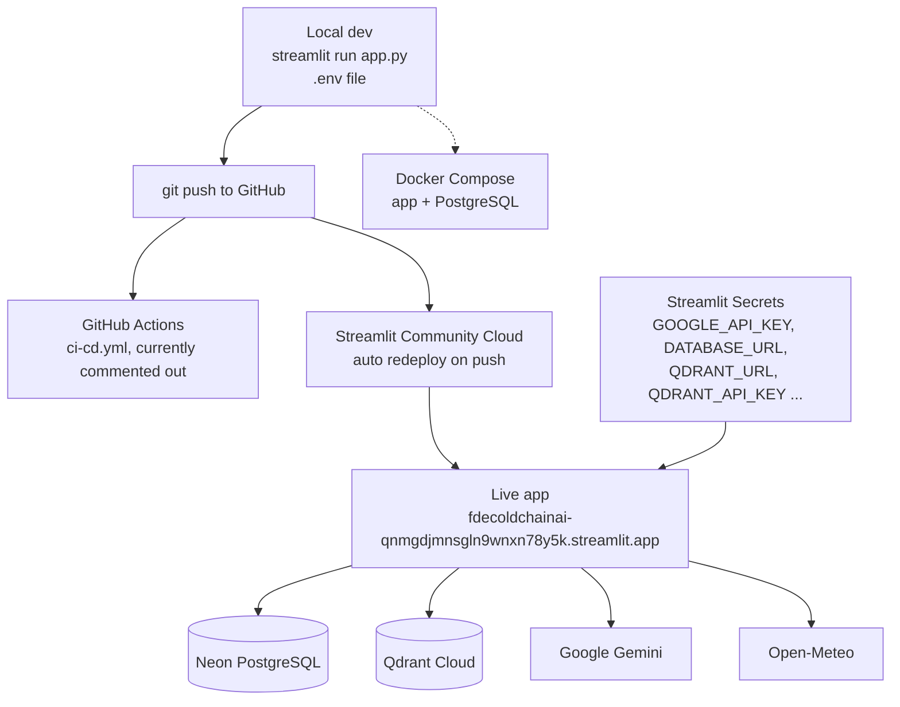

# Product Workflow

Diagrams of how Cold Chain AI works, from data setup to a user's answer. They are written in Mermaid, which renders on GitHub and in the Kiro/VS Code markdown preview.

Source files named in each diagram are the ground truth. If code changes, update the matching diagram.

## 1. System overview

## 2. Request lifecycle (one question)

## 3. Agent graph (LangGraph)

Conversation memory is kept per `thread_id` in `MemorySaver` (in process memory, lost on restart).

## 4. Tool execution and safety checks

Rules enforced: read-only SQL, secrets redacted in logs, retrieved SOP text treated as untrusted data, raw exception details not shown to the model.

## 5. Model retry

## 6. SOP knowledge pipeline (RAG)

`VECTOR_DB_PROVIDER` selects the store. `rag/migrate_chroma_to_qdrant.py` copies an existing Chroma store to Qdrant.

## 7. Data setup

## 8. Environments and deployment

Full deployment steps are in `project-overview.md` under "Live deployment".

## 9. Configuration map

| Variable | Used by | Effect |
|----------|---------|--------|
| `GOOGLE_API_KEY`, `GEMINI_MODEL` | `agent/orchestrator.py` | Gemini access and model name |
| `DB_TARGET` (`local` or `neon`) | `tools/sql_tool.py`, `scripts/ingest_data.py` | Chooses the database |
| `DATABASE_URL` | same | Neon connection string |
| `DB_HOST`, `DB_PORT`, `DB_NAME`, `DB_USER`, `DB_PASSWORD` | same | Local PostgreSQL |
| `VECTOR_DB_PROVIDER` (`chroma` or `qdrant`) | `rag/vector_store.py` | Chooses the vector store |
| `QDRANT_URL`, `QDRANT_API_KEY`, `QDRANT_COLLECTION` | `rag/vector_store.py` | Qdrant Cloud |
| `CHROMA_PATH` | `rag/vector_store.py` | Local Chroma folder |
| `AUDIT_LOG_PATH` | `agent/audit_logger.py` | Audit log file location |
